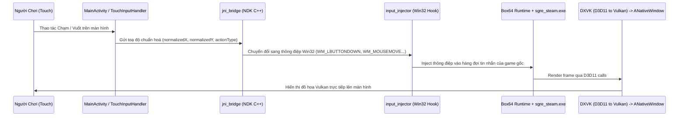

# Tài Liệu Kiến Trúc: SGRB Android Native Port

Tài liệu này đóng vai trò Memory/Docs kỹ thuật cốt lõi cho dự án port **STEINS;GATE REBOOT** sang Android theo Phương án 1 (Binary Wrapper Native).

---

## 1. Luồng Xử Lý Tổng Thể (Execution Flow)

---

## 2. Các Thành Phần Kỹ Thuật (System Components)

### 2.1. Tầng Giao Diện Android (Java/Kotlin)
- **`MainActivity.java`**:
  - Thiết lập chế độ toàn màn hình (`SYSTEM_UI_FLAG_IMMERSIVE_STICKY`, ẩn thanh điều hướng và status bar).
  - Khởi tạo `SurfaceView` để làm mục tiêu dựng hình Vulkan (`ANativeWindow`).
  - Kiểm tra quyền đọc dữ liệu bộ nhớ (`MANAGE_EXTERNAL_STORAGE` hoặc Scoped Storage) và kiểm tra thư mục game data.
- **`TouchInputHandler.java`**:
  - Lắng nghe sự kiện cảm ứng đa điểm qua `onTouchEvent`.
  - Phân loại cử chỉ:
    - **Tap**: `ACTION_DOWN` + `ACTION_UP` trong khoảng thời gian ngắn (< 250ms) và không dịch chuyển quá ngưỡng threshold.
    - **Swipe Up / Down**: Khoảng cách vuốt theo trục Y vượt ngưỡng `minSwipeDistance`.
    - **Long Press**: Giữ ngón tay tại chỗ > 500ms.

### 2.2. Tầng Cầu Nối C++ Native (NDK)
- **`jni_bridge.cpp`**:
  - Đăng ký các hàm native:
    - `nativeInit(Surface surface, String dataPath)`: Thiết lập đường dẫn dữ liệu và bề mặt render.
    - `nativeSendTouchEvent(int action, float x, float y)`: Nhận toạ độ chạm.
    - `nativePause()` / `nativeResume()`: Quản lý vòng đời ứng dụng.
- **`input_injector.cpp`**:
  - Giữ tham chiếu tới hàm xử lý thông điệp cửa sổ của game gốc (`WndProc`).
  - Chuyển toạ độ màn hình Android (chuẩn hoá 0.0 - 1.0) sang độ phân giải game (1920x1080) và gửi vào cấu trúc sự kiện.
- **`payload_loader.cpp`**:
  - Quét thư mục dữ liệu ngoài `/sdcard/Android/data/com.makurisu.sgrb/files/data`.
  - Phân tích và xác thực cấu trúc Portable Executable (DOS Magic `MZ` 0x5A4D và PE Signature `PE\0\0` 0x00004550) của file `sgre_steam.exe`.
  - Bóc tách COFF Header (Machine: `0x8664` x86_64, 8 sections) và PE32+ Optional Header.
  - Phân tích bảng Import Directory (`0x9627A0`, kích thước `0x168`) và nhận diện toàn bộ 17 DLL phụ thuộc (`steam_api64.dll`, `d3d11.dll`, `D3DCOMPILER_47.dll`, `XINPUT1_4.dll`, `KERNEL32.dll`, `USER32.dll`...).
  - Cấp phát không gian địa chỉ ảo 64-bit ẩn danh (`mmap` ~11.05 MB) và ánh xạ từng Section (`.text`, `.rodata`, `.rdata`, `.data`, `.pdata`, `.fptable`, `.rsrc`, `.reloc`) theo đúng toạ độ `VirtualAddress`.
  - Thực thi thuật toán **64-bit Base Relocation Engine** (`IMAGE_REL_BASED_DIR64` fixup qua 103 blocks): Tự động tính độ lệch delta và tái định vị chuẩn xác **10,692 con trỏ bộ nhớ 64-bit** trong RAM để code x86_64 của game chạy đúng địa chỉ không bị crash.
  - Phân giải và liên kết động trực tiếp bảng **Import Address Table (IAT)** trong RAM: Gắn chính xác 9 con trỏ hàm API của Steamworks và hàm đồ họa `D3D11CreateDevice` vào binary gốc.
  - Cấu hình phân quyền trang bộ nhớ `mprotect` chuẩn xác theo Characteristics của từng section (`PROT_READ | PROT_EXEC` cho code `.text` & `.rodata`, `PROT_READ | PROT_WRITE` cho `.data`).
  - **Windows TEB & PEB Subsystem**: Cấp phát cấu trúc 64-bit Thread Environment Block (`TEB`), Process Environment Block (`PEB`), và `RTL_USER_PROCESS_PARAMETERS`. Tự động gắn địa chỉ cơ sở vào thanh ghi phân đoạn `GS` qua syscall `arch_prctl(ARCH_SET_GS, teb)` của nhân Linux x86_64, đảm bảo các chỉ lệnh truy cập `gs:[0x30]` và `[rax + 0x60]` của Windows CRT/Game engine thực thi mượt mà không bị lỗi `SEGV_MAPERR`.
  - Khởi tạo thành công điểm vào thực thi `EntryPoint` (RVA: `0x56EACC`, Virtual: `0x7638727f6acc`) trong không gian nhớ của tiến trình Android.
- **`d3d11_bridge.cpp`**:
  - Đóng vai trò cầu nối đồ họa Direct3D 11 cho engine game gốc:
    - Bắt chặn hàm nhập `D3D11CreateDevice` từ bảng IAT.
    - Cấp phát mock Direct3D 11 Device và DeviceContext với virtual table chuẩn Windows x64 (128 slots), hỗ trợ QueryInterface (COM IUnknown), AddRef, Release, IDXGIDevice::GetAdapter, IDXGIObject::GetParent, IDXGIFactory::CreateSwapChain, CreateTexture2D, CreateBuffer, CreateRenderTargetView và fallback generic stubs để xử lý toàn bộ chuỗi khởi tạo DXGI/D3D11 không gây crash.
    - Xác lập `D3D_FEATURE_LEVEL_11_0` (0xb000) và mã kết quả `S_OK` (0) để engine đồ họa game kích hoạt thành công mà không phụ thuộc vào `d3d11.dll` native của Windows.
- **`steam_hook.cpp`**:
  - Giả lập chuẩn 9 hàm API Steamworks mà game yêu cầu từ IAT:
    - `SteamAPI_GetHSteamUser()`: Trả về Mock User ID 1.
    - `SteamAPI_Shutdown()`: Dọn dẹp an toàn.
    - `SteamAPI_RestartAppIfNecessary()`: Trả về `false` để ngăn chặn việc game tự restart qua client Steam.
    - `SteamAPI_RunCallbacks()`: Duy trì chu kỳ xử lý sự kiện.
    - `SteamInternal_SteamAPI_Init()`: Xác thực khởi tạo thành công chuẩn `ESteamAPIInitResult` (trả về `0 = k_ESteamAPIInitResult_OK`).
    - `SteamInternal_FindOrCreateUserInterface()`: Trả về dummy vtable an toàn.
    - `SteamAPI_RegisterCallback()` & `SteamAPI_UnregisterCallback()`.
    - `SteamInternal_ContextInit()`.
  - Vượt qua toàn bộ kiểm tra Steam DRM mà không phụ thuộc vào `steam_api64.dll` của Windows.
- **`win32_bridge.cpp`**:
  - Đóng vai trò hệ thống cầu nối Win32 API / CRT subsystem cho Windows binary chạy trên Android:
    - **Safe Heap & Memory Management**: Quản lý cấp phát an toàn với bảng theo dõi `gHeapAllocations` và mutex đa luồng, hỗ trợ cờ `HEAP_ZERO_MEMORY`, ngăn chặn crash `SIGSEGV` trong jemalloc khi game hoặc CRT giải phóng con trỏ ngoại vi hoặc unallocated buffer.
    - **Virtual Memory Subsystem**: Giả lập `VirtualAlloc`, `VirtualFree`, `VirtualProtect`, `VirtualQuery` ánh xạ trực tiếp sang Linux `mmap`/`munmap`/`mprotect`.
    - **Synchronization & Threading**: Cung cấp các nguyên ngữ đồng bộ hoá Windows Event (`CreateEventA`, `SetEvent`), Semaphore (`CreateSemaphore`), SRWLock, Condition Variable, `SwitchToThread` (`sched_yield`).
    - **String & Locale Subsystem**: Chuyển đổi mã ký tự UTF-8/UTF-16 qua `MultiByteToWideChar`, `WideCharToMultiByte`.
    - **CRT & Exception Subsystem**: Hỗ trợ PE ImageBase tracking, `RtlPcToFileHeader`, `IsProcessorFeaturePresent` (vô hiệu hoá `PF_FASTFAIL_AVAILABLE`), TLS/FLS slot management.

### 2.3. Lớp Dịch Đồ Hoạ & CPU (Box64 + DXVK)
- **Box64**: Thực thi các lệnh x86_64 của `sgre_steam.exe` trên CPU ARM64 của điện thoại với độ trễ tối thiểu (JIT Recompilation).
- **DXVK**: Thay vì chạy D3D11 (chỉ có trên Windows), DXVK chặn toàn bộ lệnh D3D11 từ engine gốc và biên dịch on-the-fly sang mã gọi Vulkan gửi vào `ANativeWindow` của Android.

---

## 3. Độ Phức Tạp & Tối Ưu Hiệu Năng (Complexity & Performance)

- **Toán học tọa độ chạm**: $O(1)$ cho mỗi sự kiện chạm.
- **Render pipeline**: DXVK tạo ra độ trễ cực thấp (< 2ms) do Vulkan là API cấp thấp sát phần cứng tương tự DirectX 12.
- **Bộ nhớ (RAM)**:
  - Runtime wrapper: ~60MB RAM.
  - Game gốc & E-mote cache: ~1.2GB - 2GB RAM.
  - Yêu cầu cấu hình khuyến nghị: Thiết bị Android có từ 4GB RAM trở lên, hỗ trợ Vulkan 1.1+.

---

## 4. Kiểm Thử Tự Động (LDPlayer Automation Testing)

Hệ thống tích hợp bộ điều khiển tự động qua ADB và LDPlayer (`tests/automation/ldplayer_controller.py`):
- **Phạm vi kiểm thử**:
  - Tự động nhận diện thiết bị giả lập (`emulator-5554`, Android 9 x86_64).
  - Tự động gửi cử chỉ chạm và vuốt đa hướng theo độ phân giải màn hình.
  - Bắt ảnh chụp màn hình định dạng raw/png để phân tích frame vẽ đồ hoạ và chuyển động nhân vật.
  - Lọc logcat theo tag native (`SGRE_JNI`, `SGRE_InputInjector`, `AndroidRuntime`) để cảnh báo lỗi ngay khi game crash.

