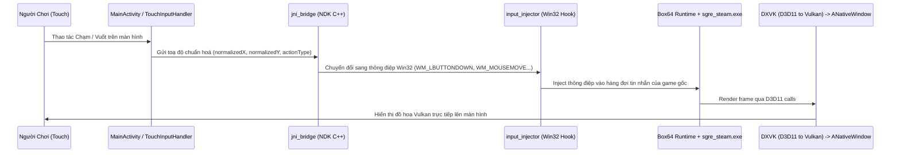

# Tài Liệu Kiến Trúc: SGRB Android Native Port

Tài liệu này đóng vai trò Memory/Docs kỹ thuật cốt lõi cho dự án port **STEINS;GATE REBOOT** sang Android theo Phương án 1 (Binary Wrapper Native).

---

## 1. Luồng Xử Lý Tổng Thể (Execution Flow)

---

## 2. Các Thành Phần Kỹ Thuật (System Components)

### 2.1. Tầng Giao Diện Android (Java/Kotlin)
- **`MainActivity.java`**:
  - Thiết lập chế độ toàn màn hình (`SYSTEM_UI_FLAG_IMMERSIVE_STICKY`, ẩn thanh điều hướng và status bar).
  - Khởi tạo `SurfaceView` để làm mục tiêu dựng hình Vulkan (`ANativeWindow`).
  - Kiểm tra quyền đọc dữ liệu bộ nhớ (`MANAGE_EXTERNAL_STORAGE` hoặc Scoped Storage) và kiểm tra thư mục game data.
- **`TouchInputHandler.java`**:
  - Lắng nghe sự kiện cảm ứng đa điểm qua `onTouchEvent`.
  - Phân loại cử chỉ:
    - **Tap**: `ACTION_DOWN` + `ACTION_UP` trong khoảng thời gian ngắn (< 250ms) và không dịch chuyển quá ngưỡng threshold.
    - **Swipe Up / Down**: Khoảng cách vuốt theo trục Y vượt ngưỡng `minSwipeDistance`.
    - **Long Press**: Giữ ngón tay tại chỗ > 500ms.

### 2.2. Tầng Cầu Nối C++ Native (NDK)
- **`jni_bridge.cpp`**:
  - Đăng ký các hàm native:
    - `nativeInit(Surface surface, String dataPath)`: Thiết lập đường dẫn dữ liệu và bề mặt render.
    - `nativeSendTouchEvent(int action, float x, float y)`: Nhận toạ độ chạm.
    - `nativePause()` / `nativeResume()`: Quản lý vòng đời ứng dụng.
- **`input_injector.cpp`**:
  - Giữ tham chiếu tới hàm xử lý thông điệp cửa sổ của game gốc (`WndProc`).
  - Chuyển toạ độ màn hình Android (chuẩn hoá 0.0 - 1.0) sang độ phân giải game (1920x1080) và gửi vào cấu trúc sự kiện.
- **`payload_loader.cpp`**:
  - Quét thư mục dữ liệu ngoài `/sdcard/Android/data/com.makurisu.sgrb/files/data`.
  - Phân tích và xác thực cấu trúc Portable Executable (DOS Magic `MZ` 0x5A4D và PE Signature `PE\0\0` 0x00004550) của file `sgre_steam.exe`.
  - Đảm bảo tính toàn vẹn binary gốc trước khi nạp vào bộ điều phối thực thi.
- **`steam_hook.cpp`**:
  - Giả lập các hàm API tối thiểu của Steamworks SDK:
    - `SteamAPI_Init()`: Luôn trả về `true`.
    - `SteamAPI_IsSteamRunning()`: Trả về `true`.
    - `SteamAPI_Shutdown()`: Giải phóng an toàn.
  - Vượt qua kiểm tra bản quyền Steam mà không làm crash game.

### 2.3. Lớp Dịch Đồ Hoạ & CPU (Box64 + DXVK)
- **Box64**: Thực thi các lệnh x86_64 của `sgre_steam.exe` trên CPU ARM64 của điện thoại với độ trễ tối thiểu (JIT Recompilation).
- **DXVK**: Thay vì chạy D3D11 (chỉ có trên Windows), DXVK chặn toàn bộ lệnh D3D11 từ engine gốc và biên dịch on-the-fly sang mã gọi Vulkan gửi vào `ANativeWindow` của Android.

---

## 3. Độ Phức Tạp & Tối Ưu Hiệu Năng (Complexity & Performance)

- **Toán học tọa độ chạm**: $O(1)$ cho mỗi sự kiện chạm.
- **Render pipeline**: DXVK tạo ra độ trễ cực thấp (< 2ms) do Vulkan là API cấp thấp sát phần cứng tương tự DirectX 12.
- **Bộ nhớ (RAM)**:
  - Runtime wrapper: ~60MB RAM.
  - Game gốc & E-mote cache: ~1.2GB - 2GB RAM.
  - Yêu cầu cấu hình khuyến nghị: Thiết bị Android có từ 4GB RAM trở lên, hỗ trợ Vulkan 1.1+.

---

## 4. Kiểm Thử Tự Động (LDPlayer Automation Testing)

Hệ thống tích hợp bộ điều khiển tự động qua ADB và LDPlayer (`tests/automation/ldplayer_controller.py`):
- **Phạm vi kiểm thử**:
  - Tự động nhận diện thiết bị giả lập (`emulator-5554`, Android 9 x86_64).
  - Tự động gửi cử chỉ chạm và vuốt đa hướng theo độ phân giải màn hình.
  - Bắt ảnh chụp màn hình định dạng raw/png để phân tích frame vẽ đồ hoạ và chuyển động nhân vật.
  - Lọc logcat theo tag native (`SGRE_JNI`, `SGRE_InputInjector`, `AndroidRuntime`) để cảnh báo lỗi ngay khi game crash.

